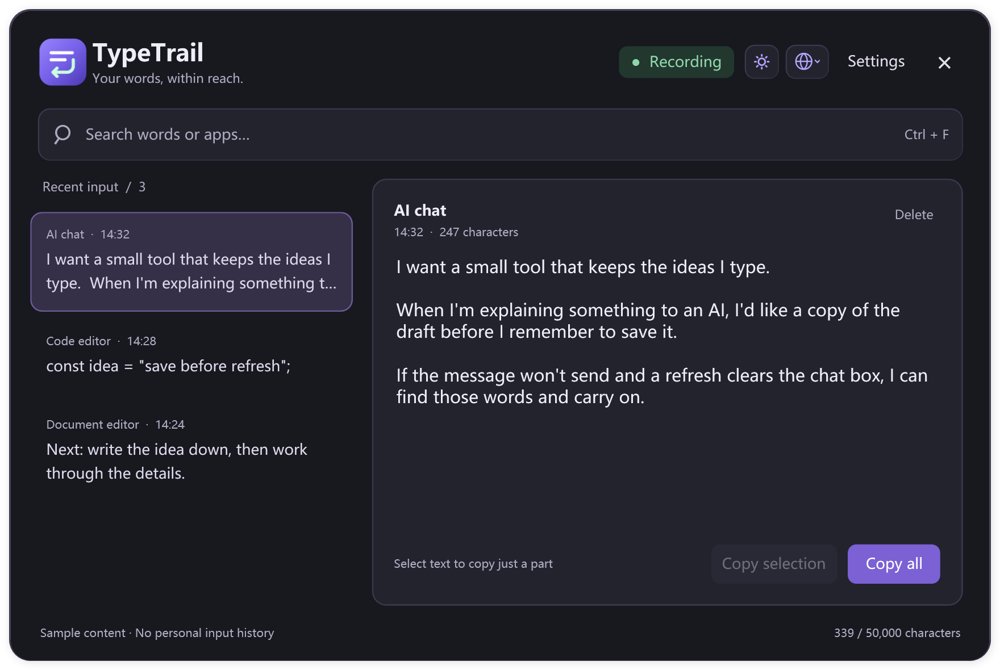
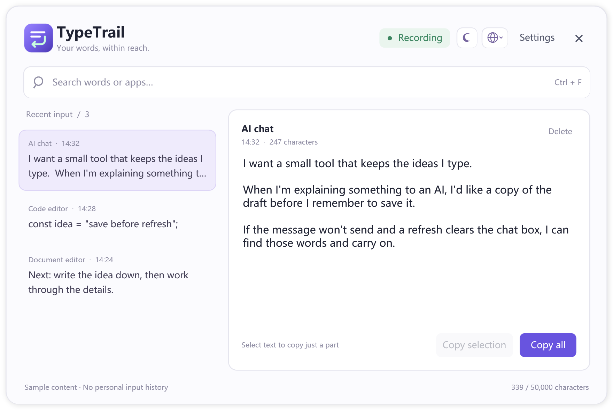

<p align="center">
  
</p>

<h1 align="center">TypeTrail</h1>

<p align="center"><strong>Your words, within reach.</strong></p>

<p align="center"><strong>English</strong> | <a href="README.zh-CN.md">简体中文</a></p>

## Why I made this

Written out a whole idea for an AI chat, only for the message to get stuck sending?

Refreshed the page and lost the draft before you could copy it?

Tried to write it again, but couldn't quite get back to what you meant?

I made TypeTrail after this happened to me. I still knew roughly what I wanted to say, but had to put all the context and detail back into words. When I'd already spent my energy writing it once, starting over was the last thing I wanted to do.

TypeTrail keeps a local history of what you type. If a draft disappears, open the history, find it and copy it back, much like clipboard history. I built it for AI drafts; it also works for messages, forms and searches in supported apps.

The current release is for Windows. You can use it in Chinese or English, search your history, and copy a whole entry or just the part you need.

## Features

- **Chinese IME support.** Records confirmed text such as “你好” in supported fields, skips cancelled Pinyin compositions and filters out duplicate reports of the same input.
- **Keeps earlier drafts.** Clearing the original input field marks the entry as **Cleared**, while earlier versions remain available. Backspace, Delete and some selection edits are tracked too.
- **Recovery across Windows apps.** Runs in the background and works with browser fields and other supported Windows apps. No browser extension is needed.
- **Focused on new input.** When you open an existing document, its text is used only to compare later changes. It isn't copied wholesale into history.

## Preview

These previews use the app's interface resources and sample text. They contain no personal input history.



<details>
<summary>View light mode</summary>



</details>

## Install and use

Download `TypeTrail-Setup-1.0.0-x64.exe` from this repository's **Releases** page. You need **Windows 10 / 11 x64**. Input from supported 32-bit apps is included. This release is for Windows only.

You also need **.NET Framework 4.8 or later**. If the installer says it's missing, install the [official Microsoft runtime](https://dotnet.microsoft.com/download/dotnet-framework/net48), then run the TypeTrail installer again.

1. After installation, search for **TypeTrail** in the Start menu and open it.
2. Leave it running in the background and type as usual. The button at the top right shows the recording status. Click it to pause or resume.
3. Press **Alt + backtick (&#96;)** to open history. On many keyboards, the backtick key is below Esc, to the left of 1. You can change the shortcut in Settings.
4. Pick an entry on the left, or search for text or an app name. Click **Copy all**, or highlight a passage and click **Copy selection**, then paste it back into your app.

Closing the window or pressing Esc hides it in the background. Click the tray icon to open it again. To quit completely, use the tray menu. You can turn on launch at sign-in during installation or in Settings.

Use the sun / moon button to switch themes and the globe menu to choose English, Simplified Chinese or your system language. History holds **50,000 characters** by default; older content is removed as it fills up. In Settings, you can change that limit, choose whether history is saved after quitting, and exclude apps.

If you clear the original input field, the entry shows a **Cleared** marker. Use the version menu on the right to view earlier drafts that have been kept. Clearing the field does not delete TypeTrail's history.

**Start TypeTrail before you begin typing.** It can't recover words it never recorded.

The installer does not currently have a Windows publisher signature. Download it from this repository's Releases page and check it against `SHA256SUMS.txt` in the same release. Don't turn off your security software to install it.

## Privacy and data

**The app does not upload your input history or send the text you type to a server.** There's no signup, login, cloud sync or input upload feature. History is stored in `%LOCALAPPDATA%\TypeTrail` and encrypted for the current Windows user. Malware running as that same user may still be able to read it. Text you've copied or exported is no longer protected by this encryption.

Standard password fields, read-only areas and excluded apps are skipped, but some custom fields cannot be identified reliably. **Pause recording or exclude the app before entering passwords, verification codes, keys or other sensitive information.**

Uninstalling keeps history and settings by default. To remove them too, quit the app, then delete the data directory and any backups. Clearing history isn't secure erasure; copies in the clipboard, system snapshots or other locations need to be removed separately.

Use TypeTrail only on devices and accounts you have permission to use, and make sure anyone whose input may be recorded knows and agrees. Don't record someone else's typing without permission.

## When capture may be incomplete

TypeTrail uses Windows input events and text provided by controls. Tests cover native x64 / x86 edit controls, web fields, Microsoft Pinyin, Sogou Pinyin, English and mixed Chinese / English input. Some apps and input methods may still not work correctly.

Protected or elevated apps, some custom-drawn fields, editors that expose only raw key codes, and certain custom paste operations may produce partial records or none at all. Complex caret movements, selections and undo operations can't always be reconstructed. If an edit can't be followed reliably, the previous fragment is kept as an earlier version.

System or app updates, slow responses and storage failures can also affect recording. If saving history is enabled but new history can't be written to disk, TypeTrail cancels a normal quit and shows a warning. Forced termination or power loss can still lose unsaved content.

If you see a limited or incomplete recording warning, copy important text yourself. Save long drafts elsewhere too, rather than relying on TypeTrail as your only copy.

## Architecture

This repository contains source code, resources, build scripts and the installer. Installers are distributed separately as **Releases** attachments.

<details>
<summary>Modules and input processing</summary>

| Path | Responsibility |
| --- | --- |
| `src/TypeTrail/Bootstrap/` | Startup, single-instance coordination, profile identity and startup health. |
| `src/TypeTrail/Application/` | UI coordination, capture orchestration, settings, saving and application lifecycle. |
| `src/TypeTrail/Capture/Channels/` | Native bridge, x86 host and capture channels for different control types. |
| `src/TypeTrail/Capture/Keyboard/`, `Ime/` | Keyboard activity, editing commands, IME composition and committed text. |
| `src/TypeTrail/Capture/Evidence/` | Field admission, attribution of text to user input and deduplication. |
| `src/TypeTrail/Capture/Protection/`, `Paste/` | Sensitive fields, app exclusions and paste confirmation. |
| `src/TypeTrail/History/` | Input journal, caret and selection tracking, deletion, earlier drafts and character limits. |
| `src/TypeTrail/History/Unicode/` | Unicode grapheme boundaries to avoid splitting emoji and combining characters. |
| `src/TypeTrail/Persistence/` | Encryption for the current Windows user, compression, atomic saving, backups and recovery. |
| `src/TypeTrail/Presentation/` | WPF interface, themes and localization. |
| `src/TypeTrail/Configuration/`, `Platform/`, `Properties/` | Configuration models, Windows APIs and application metadata. |
| `src/native/` | Native x64 input bridge, thread registration, activity notifications and hook cleanup. |
| `src/companion/` | x86 host and its communication protocol with the main application. |
| `src/tsf-input-analysis/` | TSF text services observer used by the input bridge at runtime. |
| `scripts/` | Application compilation and source manifest checks. |
| `installer/` | Installation, updates, application shutdown and shortcuts. |

### Input processing

Keyboard activity, IME commits and text reported by controls pass through input
attribution, protection checks and deduplication before entering the input journal.
Existing document text serves only as a temporary comparison baseline; it is not
imported wholesale to fill gaps in history.

Chinese input is recorded as committed text. Cancelled Pinyin composition is not
saved, and reports of the same input from multiple channels must not create
duplicates. Caret and selection tracking is limited to ranges confirmed to belong
to recorded text. When an edit cannot be followed reliably, the previous fragment
is retained with a label. Deleting all text leaves a cleared marker, while complete
earlier drafts are kept separately.

History is compressed, encrypted for the current Windows user and saved through
atomic file replacement. If a read fails, the original file is protected and
retried. New input remains in memory during recovery and is merged afterward.
If new history cannot be written to disk, a normal quit is cancelled with a
warning. See “When capture may be incomplete” above for the limits of forced termination and
power loss.

The main application's C# files are explicitly listed in
`src/TypeTrail/sources.txt`. The native bridge and x86 host are built separately.
Stable component filenames and interfaces preserve compatibility with input
bridges that Windows may still have loaded in other applications. Each capture
channel covers different controls; they cannot simply replace one another.

</details>

## Build from source

<details>
<summary>Tools and build commands</summary>

Run commands from the repository root in Windows PowerShell 5.1.
The app requires Windows 10 / 11 x64 and .NET Framework 4.8 or later.

### Build tools

- The .NET Framework C# compiler included with Windows.
- Visual Studio 2022 Build Tools, MSVC 14.41.34120, with x64 and x86 tools.
- Windows SDK 10.0.22621.0.
- Inno Setup 7.1.0 for the installer.

The native scripts use the listed MSVC and SDK paths. If your tools are installed
elsewhere, adjust `src/native/build.ps1` and `src/companion/build.ps1` first.

### Application

```powershell
powershell.exe -NoProfile -File .\build.ps1
```

This builds the WPF app, native x64 input bridge and x86 companion into `bin/`.
All three components are needed for the full supported capture coverage.
`src/TypeTrail/sources.txt` lists the application source files; compilation checks
for missing, duplicate and unlisted files.

### Installer

```powershell
powershell.exe -NoProfile -File .\installer\build-installer.ps1 -CompilerPath C:\path\to\ISCC.exe
```

Output: `dist/TypeTrail-Setup-1.0.0-x64.exe`. To use a different app output folder,
pass `-PayloadDirectory`; use `-OutputDirectory` for the installer destination.
Intermediate files are kept in `.build/installer/`.

Only explicitly listed runtime files, user guides and the Unicode license are
packaged. Do not put personal history or settings in a build folder. User data
belongs in `%LOCALAPPDATA%\TypeTrail`, separately from the installed application.
The installer does not currently have a Windows publisher signature.

</details>

## Feedback

If text is missing, duplicated or deleted incorrectly, please open an Issue. Tell me your Windows and TypeTrail versions, which app and input method you use, and how to reproduce the problem. A short example without private information is enough. Please don't upload your full input history.

## Disclaimer

This software is provided **AS IS**, without guarantees of complete compatibility, continuous availability or complete capture. Choose what to record and keep separate copies of important content.

To the extent permitted by applicable law, the author and contributors are not liable for data loss, disclosure, work interruptions or other losses arising from the use of, or inability to use, this software. Users must comply with applicable laws and their organization's rules. Do not record, monitor or share another person's input without authorization; responsibility for such use rests with the user. This disclaimer does not exclude or limit liability that cannot legally be excluded or limited.
